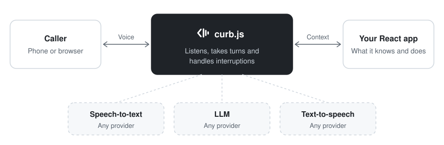
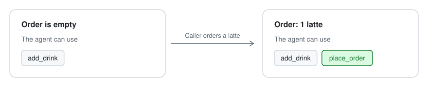

<div align="center">
  <h1>curb.js</h1>
  <p><strong>The React framework for voice agents.</strong></p>

<a href="https://kugelaudio.com"></a>


  <p>
    <a href="#quickstart"><strong>Quickstart</strong></a> ·
    <a href="#how-an-agent-is-built"><strong>How it works</strong></a> ·
    <a href="#the-dev-loop"><strong>The dev loop</strong></a> ·
    <a href="#deploy-to-kugelaudio"><strong>Hosted by KugelAudio</strong></a> ·
    <a href="#status"><strong>Status</strong></a>
  </p>
</div>

---

curb.js gives you a working voice agent out of the box. You write what it
knows and what it can do, as React components.

- **Voice is done.** Speech, turn-taking and interruptions are handled for you.
- **State changes the agent.** Tools and knowledge appear and disappear as
  your state changes, like UI in a React app.
- **Bring any model.** Use any speech-to-text, text-to-speech or LLM provider,
  hosted or self-hosted. Swapping one is a single line.
- **See every turn.** The dev preview shows exactly what the model saw, every
  tool call and every audio clip.

<p align="center">
  <picture>
    <source media="(prefers-color-scheme: dark)" srcset=".github/assets/how-it-works-dark.svg">
    
  </picture>
</p>

> **Don't want to run infrastructure?** KugelAudio hosts curb agents for you,
> with phone numbers, scaling and call logs included.
> [Deploy on KugelAudio →](https://kugelaudio.com) · [How hosting works](#hosting)

Here is a complete skill, a coffee counter:

```tsx
import { useState } from "react";
import { z } from "zod";
import { Instruction, Tool } from "curb";

export default function Counter() {
  const [order, setOrder] = useState<string[]>([]);

  return (
    <>
      <Instruction>Take the customer's coffee order.</Instruction>

      {order.length === 0 ? "The order is empty." : `Current order: ${order.join(", ")}.`}

      <Tool
        name="add_drink"
        description="Add a drink to the order."
        schema={z.object({ drink: z.string() })}
        onSubmit={({ drink }) => {
          setOrder([...order, drink]);
          return { ok: true, message: "Added." };
        }}
      />

      {order.length > 0 && (
        <Tool
          name="place_order"
          description="Send the order to the bar."
          onSubmit={() => {
            setOrder([]);
            return { ok: true, message: "Order placed." };
          }}
        />
      )}
    </>
  );
}
```

Whatever the component renders is what the agent knows and can do right now.
`place_order` only exists once there is a drink in the order.

<p align="center">
  <picture>
    <source media="(prefers-color-scheme: dark)" srcset=".github/assets/state-changes-dark.svg">
    
  </picture>
</p>

## Quickstart

You need Node.js 22.12 or newer.

```bash
npm create kugelaudio my-agent
cd my-agent
npx curb login         # sign in once in the browser
npm run dev            # open http://127.0.0.1:4000
```

The installer asks which provider to use for speech-to-text, the LLM and
text-to-speech, then sets up the project. The defaults run everything on
KugelAudio, so `curb login` is all the setup you need. Anthropic, OpenAI,
Deepgram, ElevenLabs, Cartesia and any OpenAI-compatible endpoint are one pick
away.

`npm run dev` opens the **preview**, where you talk to your agent: type, or
press **Start call** and speak. The starter agent is **Juno**, a personal
assistant. Ask her "how does this work?".

> Not on npm yet. For now, scaffold from a checkout of this repo:
> `npm install` once at the root, then `npm run new -- ~/my-agent`.

To update a project later, run `npm run upgrade` inside it.

## Hosting

A curb agent runs anywhere Node runs, with your own LiveKit and your own
provider keys. Set `LIVEKIT_URL`, `LIVEKIT_API_KEY` and `LIVEKIT_API_SECRET`,
then run `npm start` to start the production worker. `npx curb build` packs
the project into one self-contained directory. See
[hosting.md](packages/framework/docs/hosting.md) for all the ways to run an
agent.

### Deploy to KugelAudio

Rather not run LiveKit, workers and telephony yourself? KugelAudio builds,
verifies and hosts your agent, with phone numbers, call logs and scaling
handled for you.
**[Deploy on KugelAudio →](https://kugelaudio.com)**

```bash
npx curb login          # sign in once
npx curb secrets push   # send your .env keys to the hosted agent
npx curb deploy         # build and go live, prints a playground link
```

See [deploy.md](packages/framework/docs/deploy.md) for flags and limits.

## Why it works well

- **You always know what the model sees.** The whole context is the output
  of one render, and the preview shows it for every turn.
- **Skills load only when needed.** Each skill is one topic, like a page, so
  even an agent with 50 skills sends a small prompt.
- **Natural conversation is built in.** Agents wait while a caller thinks,
  check in after a long pause and know exactly where they were cut off.
- **You can see why anything happened.** Replay any call, rewind to any turn,
  and copy a transcript for Claude Code or Cursor to improve your agent.

## How an agent is built

Everything you write lives in `src/agent/`:

```text
my-agent/
  src/agent/
    agent.tsx          # who the agent is: prompt, voice, model, skills
    counter/skill.tsx  # one skill per topic
    menu/skill.tsx
  context/menu.md      # plain markdown the agent can know
```

**A skill is a component plus a short description** that tells the model when
to use it:

```tsx
import { Instruction, Text, type SkillMeta } from "curb";

export const meta: SkillMeta = {
  title: "Menu",
  description: "The Curb Café menu: drinks, sizes, prices.",
};

export default function Menu() {
  return (
    <>
      <Instruction>Answer menu questions from the menu below.</Instruction>
      <Text src="menu.md" />
    </>
  );
}
```

Knowledge is just markdown. Edit `menu.md`, save, and the agent knows the new
prices.

**The agent is a few lines in `agent.tsx`:**

```tsx
import { Agent, Skill, Skills, SystemPrompt, defineAgent } from "curb";
import { kugelaudio } from "curb/providers";

function App() {
  return (
    // Providers are props: swap any of them in one line.
    <Agent llm={kugelaudio.llm()} tts={kugelaudio.tts({ voice: 1072, language: "en" })}>
      <SystemPrompt>
        You are Kona, the barista at Curb Café. Be warm and quick, one or
        two sentences per reply.
      </SystemPrompt>
      <Skills>
        <Skill path="/counter" description="Use for coffee orders.">The counter</Skill>
        <Skill path="/menu" description="Menu questions: drinks, sizes, prices.">Menu</Skill>
      </Skills>
    </Agent>
  );
}

export const agent = defineAgent({ app: App });
```

From here it grows like any React app:

- **`createAgentStore`**: state shared across skills.
- **`<Gate>`**: content and tools unlocked only after a check, like an order number.
- **`<Procedure>`**: a step-by-step workflow the agent follows.
- **`<Mcp>`**: tools from any MCP server, like Linear or Notion.
- **`useAgentInfo`**: outside data, like the caller's phone number.

## The dev loop

The preview turns your agent into a UI you can click through: tools become
forms, a `<Gate>` becomes a login card, a `<Procedure>` a stepper. Anything the
model can do, you can do by hand.

- **Type or talk** in the same conversation.
- **Replay calls** with the real audio, interruptions included.
- **Inspect the context** the model saw on every turn.
- **Catch mistakes** with `curb check`, which explains how to fix each one.
- **Copy for a coding agent** to improve your agent from a real conversation.

## Repository layout

```text
curb.js/
  packages/framework/             # the framework (published as "curb")
  packages/create-framework-app/  # the scaffolder (create-curb-app)
  packages/create-kugelaudio/     # npm create kugelaudio
  examples/insurance-agent/       # a bigger demo: claims, gate, procedure
  examples/ops-agent/             # an MCP-heavy example
```

```bash
npm install     # once, at the repo root
npm run dev     # the insurance example on http://127.0.0.1:4000
npm test        # framework test suite
```

## Status

curb.js is in active development ahead of its first public release. APIs may
still change and the packages are not on npm yet. Feedback is very welcome.

Built by [KugelAudio](https://kugelaudio.com).

## License

curb.js is licensed under the [Apache License 2.0](LICENSE).
Copyright 2026 KugelAudio GmbH. Third-party components and their licenses are
listed in [THIRD_PARTY_NOTICES.md](THIRD_PARTY_NOTICES.md).
