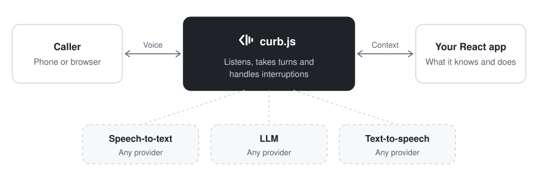

<div align="center">
  <h1>
    <picture>
      <source media="(prefers-color-scheme: dark)" srcset=".github/assets/logo-on-dark.svg">
      
    </picture>
  </h1>
  <p><strong>The framework for production voice agents.</strong></p>
  <p>Dynamic prompting with full control, in plain code you own. Your coding agent can build, test, and simulate conversations before it ships.</p>
  <p>
    <a href="#quickstart"><strong>Quickstart</strong></a> ·
    <a href="#how-it-works"><strong>How it works</strong></a> ·
    <a href="#hosting"><strong>Hosting</strong></a> ·
    <a href="https://curbjs.com/docs/"><strong>Docs</strong></a>
  </p>
</div>

curb.js gives you a working voice agent out of the box. You write what it
knows and what it can do, as React components.

| You write | Curb runs for you |
| --- | --- |
| Who the agent is: a system prompt | Speech-to-text, the LLM and text-to-speech, each swappable in one line |
| What it can do: tools, as functions with typed input | Turn-taking, interruptions and pauses on a live call |
| What it knows: skills and plain markdown | The model's request on every turn: only the instructions and tools your state allows |
| Conversations to keep as tests | A preview where you talk to the agent and see what the model saw |

Run the agent on your own servers, or let KugelAudio host it with phone numbers and call logs:
see [Hosting](#hosting).

A receptionist for a bike workshop, in `src/agent/agent.tsx`:

```tsx
import { useState } from "react";
import { Agent, GlobalTools, Skill, Skills, SystemPrompt, Tool, defineAgent, z } from "curb";
import { kugelaudio } from "curb/providers";

function App() {
  const [booked, setBooked] = useState<string>();

  return (
    <Agent llm={kugelaudio.llm()} stt={kugelaudio.stt()} tts={kugelaudio.tts()}>
      <SystemPrompt>
        You are Mia, the receptionist at Parkside Bikes. Keep your replies short.
      </SystemPrompt>

      {booked ? `Booked: ${booked}.` : "Free slots: Tuesday 9:00, Thursday 11:00."}

      <GlobalTools>
        <Tool
          name="book_repair"
          description="Book a repair appointment in a free slot."
          schema={z.object({ slot: z.string() })}
          onSubmit={({ slot }) => {
            setBooked(slot);
            return { ok: true, message: `Booked for ${slot}.` };
          }}
        />
        {booked && (
          <Tool
            name="cancel_booking"
            description="Cancel the caller's appointment."
            onCall={() => {
              setBooked(undefined);
              return { ok: true, message: "Cancelled." };
            }}
          />
        )}
      </GlobalTools>

      <Skills>
        <Skill path="/prices">Repair prices</Skill>
      </Skills>
    </Agent>
  );
}

export const agent = defineAgent({ app: App });
```

Whatever `<Agent>` renders is what the model knows and can do right now. `cancel_booking` exists
only once a slot is booked, so the model cannot call it before. `/prices` is a
[skill](#how-it-works): the model opens it when the caller asks what a repair costs.

## Quickstart

You need Node.js 22.12 or newer, on Linux or macOS, or on Windows through WSL.

```bash
npm create curb.js my-agent
cd my-agent
npx curb login         # sign in once in the browser
npm run dev            # open http://127.0.0.1:4000
```

`npm run dev` opens the **preview**, where you talk to your agent: type, or press **Start call**
and speak. The starter agent is **Juno**, a personal assistant. Ask her "how does this work?",
then make `src/agent/agent.tsx` your own.

The defaults run speech-to-text, the LLM and text-to-speech on KugelAudio, so
`curb login` is all the setup you need. Flags to `npm create curb.js` pick
Anthropic, OpenAI, Azure, Deepgram, ElevenLabs, Cartesia or any OpenAI-compatible
endpoint instead.

> **The package is `curb.js`, not `curb`.** `curb` on npm is an unrelated templating
> package, so `npm i curb` installs the wrong thing. Start with `npm create curb.js`
> rather than `npm i curb.js`: the project depends on the framework through an alias,
> `"curb": "npm:curb.js@<version>"`, and your code imports from `"curb"`.

## How it works

<p align="center">
  <picture>
    <source media="(prefers-color-scheme: dark)" srcset=".github/assets/how-it-works-dark.svg">
    
  </picture>
</p>

- **Your components are the prompt.** Curb renders them the way React renders UI, and the output
  is the model's request: instructions, knowledge and tools. When your state changes, the request
  changes with it, and a tool your code does not render is not in it.
- **Skills load only when needed.** A skill is one topic in a folder of its own. The model sees
  its description and opens it when the call gets there, so an agent with 50 skills still sends
  a small prompt.
- **Every provider is a prop.** Speech-to-text, the LLM and text-to-speech are set on `<Agent>`,
  hosted or self-hosted. Swapping one is a single line.

The `/prices` skill of the agent above is a description and a component:

```tsx
// src/agent/prices/skill.tsx
import { Instruction, Text, type SkillMeta } from "curb";

export const meta: SkillMeta = {
  title: "Repair prices",
  description: "Use when the caller asks what a repair costs.",
};

export default function Prices() {
  return (
    <>
      <Instruction>Quote prices only from the list below.</Instruction>
      <Text src="prices.md" />
    </>
  );
}
```

`prices.md` is plain markdown in the project's `context/` folder. Edit it, save, and the agent
quotes the new prices.

From there an agent grows like any React app:
[shared state](https://curbjs.com/docs/state/), [step-by-step procedures](https://curbjs.com/docs/procedures/),
[confirmations](https://curbjs.com/docs/confirmations/) and [tools from any MCP server](https://curbjs.com/docs/mcp/).

## Test before it ships

- `npm run dev`: talk to the agent, replay a call with its audio, and see what the model saw on every turn.
- `npx curb check`: type-checks the project and explains how to fix each mistake.
- `npx curb say "Do you have a slot on Tuesday?"`: one caller turn in the terminal, with the reply and the tool calls.
- `npx curb test`: runs whole conversations as tests, with no microphone.

A new project comes with an `AGENTS.md`, so Claude Code or Cursor can run these commands and
improve the agent from a real conversation.

## Hosting

A Curb agent runs anywhere Node runs, with your own LiveKit and your own provider keys: set
`LIVEKIT_URL`, `LIVEKIT_API_KEY` and `LIVEKIT_API_SECRET`, then run `npm start`. `npx curb build`
packs the project into one self-contained directory. See
[hosting.md](packages/framework/docs/agent-guide/hosting.md) for all the ways to run an agent.

Or let KugelAudio build and host it, with phone numbers, call logs and scaling handled for you.
Hosting is switched on for your organization on request (hello@kugelaudio.com):

```bash
npx curb secrets push   # send your .env keys to the hosted agent
npx curb deploy         # build and go live, prints a playground link
```

See [deploying.md](packages/framework/docs/agent-guide/deploying.md) for flags and limits.

## Documentation

The docs live on [curbjs.com](https://curbjs.com/docs/):

- [Installation](https://curbjs.com/docs/installation/): create a project and talk to it.
- [How Curb works](https://curbjs.com/docs/how-it-works/): from a React render to a spoken reply.
- [Agents and skills](https://curbjs.com/docs/agents-and-skills/): structure what an agent knows.
- [Tools](https://curbjs.com/docs/tools/): give it things to do.
- [Providers](https://curbjs.com/docs/providers/): swap the LLM, speech-to-text or text-to-speech.
- [Testing](https://curbjs.com/docs/testing/): simulate conversations before they reach a caller.
- [Self-hosting](https://curbjs.com/docs/hosting/): run an agent on your own servers.

## Status and contributing

curb.js is in active development and its APIs may still change. Feedback is very welcome:
[CONTRIBUTING.md](CONTRIBUTING.md) says where questions, bugs and pull requests go, and how this
repository is laid out.

## License

curb.js is licensed under the [Apache License 2.0](LICENSE).
Copyright 2026 KugelAudio GmbH. Third-party components and their licenses are
listed in [THIRD_PARTY_NOTICES.md](THIRD_PARTY_NOTICES.md).
